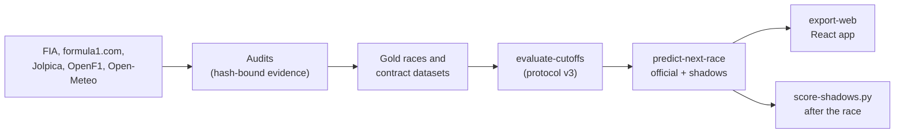

# F1 ML Project

Point-in-time Formula 1 race and championship predictions. Every prediction uses
only information that was public before its cutoff, and every training race is
audited from official FIA documents.

**Status (6 November 2026):** development predictions are published for each
2026 race weekend, trained on 99 audited Gold races (2022 to the 2026 Mexico
City GP). No model has passed the formal selection gate yet, so every output is
labelled `development_only`, not a validated forecast. Candidate improvements
(weather, wet-weather skill, tyre and pit strategy, a sharper winner draw) run as
**shadow predictions** next to the official one and are scored on new races.

Start with the [pipeline overview](docs/PIPELINE.md): it has diagrams of the data
flow, trust rules, model, shadows, and the race-weekend and post-race checklists.



## Setup

Python 3.11 or newer, from the repository root:

```powershell
python -m venv .venv
.\.venv\Scripts\python.exe -m pip install -e ".[dev]"
.\.venv\Scripts\python.exe -m pip install -e ".[xgboost,catboost,lightgbm,audit]"
```

Checks (all must pass before a commit):

```powershell
.\.venv\Scripts\python.exe -m pytest
.\.venv\Scripts\python.exe -m ruff check .
.\.venv\Scripts\python.exe -m ruff format --check .
.\.venv\Scripts\python.exe -m mypy
cd web; npm run typecheck; npm run lint; npm run test
```

Tests use mocks and need no network access.

## On a race weekend

```powershell
# Any time before qualifying: pre-weekend prediction
.\.venv\Scripts\python.exe -m f1_ml_predictor predict-next-race

# After qualifying, before the race: post-qualifying prediction plus shadows
.\.venv\Scripts\python.exe -m f1_ml_predictor predict-next-race
```

`predict-next-race` runs one collector tick, picks the contract for the current
cutoff (pre-weekend, sprint, post-qualifying or pre-race), fits the models on
Gold races before the cutoff and publishes race probabilities, a season
simulation and `report.md` under `data/predictions/development/next_race/`. After
a post-qualifying or pre-race run it also freezes the shadow predictions and
prints them under the report (`--no-shadows` skips them). The Windows scheduled
collector is disabled, so these runs are made by hand. Details:
[development predictions](docs/DEVELOPMENT_PREDICTIONS.md).

## After a race

A fixed chain of audits brings the new race into Gold, refreshes the weather,
strategy and results data, and scores the shadows. The ordered checklist with
every command is in [the pipeline overview](docs/PIPELINE.md#after-the-race).

## Web frontend

```powershell
.\.venv\Scripts\python.exe -m f1_ml_predictor export-web
cd web
npm install
npm run dev
```

`export-web` verifies every run's hashes and probability contracts and writes
display-ready JSON to `web/public/data/`. The React app shows the predicted order,
race probabilities, both championships, the actual result against the
prediction, the shadow predictions and model details; it never computes
predictions. Stop the dev server before re-exporting on Windows. See
[web frontend](docs/WEB_FRONTEND.md).

## Documentation

| Document | What it covers |
| --- | --- |
| [Pipeline overview](docs/PIPELINE.md) | Diagrams, trust rules, contracts, shadows, weekend and post-race checklists |
| [Data trust](docs/DATA_TRUST.md) | Evidence classes, tiers, publication rules for every source |
| [Gold workflow](docs/GOLD_WORKFLOW.md) | How races are audited into Gold |
| [Feature dictionary](docs/FEATURE_DICTIONARY.md) | Every predictor and its availability rule |
| [Protocol v3](docs/EVALUATION_PROTOCOL_V3.md) | The frozen evaluation, calibration and selection method |
| [Modeling](docs/MODELING.md) | Candidate models, calibration, joint simulation |
| [Development predictions](docs/DEVELOPMENT_PREDICTIONS.md) | `predict-next-race`, sprints, shadows, outputs |
| [Simulation](docs/SIMULATION.md) | Championship simulation |
| [Scoring ledger](docs/SCORING_LEDGER.md) | Audited championship points |
| [Web frontend](docs/WEB_FRONTEND.md) | Export contract and React app |
| [Project plan](docs/PROJECT_PLAN.md) | Milestones, decisions, open risks |

Dated reports record individual results and are not edited afterwards:
[weather addendum](docs/WEATHER_FORECAST_ADDENDUM_2026-11-06.md),
[strategy addendum](docs/STRATEGY_ADDENDUM_2026-11-06.md),
[provisional-grid cohort](docs/PROVISIONAL_GRID_COHORT_2026-10-11.md),
[historical enrichment](docs/GOLD_HISTORICAL_ENRICHMENT_2026-10-01.md),
[scoring evaluation](docs/SCORING_EVALUATION_2026-10-01.md),
[DNF audit status](docs/DNF_AUDIT_STATUS.md),
[baseline regression audit](docs/BASELINE_REGRESSION_AUDIT.md) and the Gold
recovery and expansion reports.

## Lower-level commands

| Command | Purpose |
| --- | --- |
| `ingest-season <season>` | Jolpica schedules, results and standings into `data/normalized` (`--refresh` for an older season) |
| `list-openf1-sessions`, `ingest-openf1-session`, `ingest-fastf1-session` | Session enrichment (FastF1 needs `.[fastf1]`) |
| `capture-forecast <season> <round>` | Live Open-Meteo forecast for an event in the next seven days |
| `collect-next-race`, `collection-status` | One prospective collector tick, and its state |
| `build-benchmarks`, `backtest`, `compare-models` | Tiered benchmarks and earlier model comparisons |
| `evaluate-cutoffs [--contracts ...]` | Protocol v3 evaluation per contract, cached by exact inputs |
| `build-gold-enrichment`, `build-gold-scoring`, `build-gold-sprints` | Gold rebuild steps |
| `model-hardware` | CPU/GPU probe for the boosting backends |
| `export-web` | Frontend data |

Run `python -m f1_ml_predictor <command> --help` for options.

## Graphify

A git post-commit hook updates the local knowledge graph in `graphify-out/`
after each commit.
