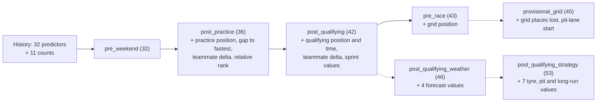

# Pre-Race Feature Dictionary

Feature version: `2`. Version 1 snapshots remain readable as Development data.
Snapshots use explicit post-qualifying, provisional-grid, or pre-race cutoffs.

## Input and availability contract

The builder consumes `FeatureInputs`: a published event specification, roster and
qualifying versions, and optional result/session/forecast/context versions.
`PublishedTable` requires a UTC availability timestamp and nonempty evidence
reference for known publications. Unknown optional versions are excluded; unknown
or late required versions cause an error. Existing row availability cannot be
backdated by the wrapper.

Publication evidence is an explicit curator trust boundary. A timestamp or evidence
string cannot prove historical release by itself. Verify the exact source version
before constructing a known publication. The builder never invents historical
availability for retrospective API downloads. Published qualifying cancellation
leaves classification missing; explicit pit-lane starts have no numeric grid ordinal.
See [data trust](DATA_TRUST.md) for evidence classes and certification policy.

The latest known complete version is selected at the cutoff. Equal-time ambiguity
is rejected. Prior results must precede the target event identifier and have
completed before cutoff. Current/future rounds are excluded even with misdated
source timestamps. Each row records the conservative maximum `feature_timestamp`,
input references/content hashes, event/completion timestamps, window, source policy,
and prediction cutoff. No target labels enter this table.

## Values

Every numeric feature has a Boolean `<feature>_missing` column. Missing values are
null, never filled from future results or actual race weather.

| Feature | Definition and allowed inputs |
| --- | --- |
| `qualifying_position` | Published current qualifying classification position. |
| `qualifying_last_session_seconds` | Latest available stage in Q3, Q2, Q1 order. Not minimum time across stages. |
| `grid_position` | Published roster/grid position only. No current race-result grid or qualifying fallback. |
| `teammate_qualifying_position_delta` | Driver position minus mean known position of current roster teammates. |
| `recent_finish_mean` | Mean classified position in the driver's last `form_window` known prior starts, default five, possibly across seasons. |
| `recent_dnf_rate` | Mean explicit audited Boolean DNF labels in those starts. Unknown statuses stay unlabeled. |
| `constructor_recent_finish_mean` | Mean classified position of constructor drivers in the last `form_window` known prior events. Performance proxy, not physical pace. |
| `recent_pit_stop_seconds` | Mean supplied prior-race mean pit duration across recent starts. Duration definition must be consistent upstream. |
| `practice_best_seconds` | Minimum best lap among known practice driver/compound summaries from one source. |
| `practice_median_seconds` | Unweighted mean summary median across known practice sessions/compounds. Conditions and fuel loads are not corrected. |
| `tyre_age_mean` | Mean known median tyre age across those summaries. Not estimated degradation. |
| `tyre_compound_count` | Distinct known practice compounds. All unknown yields missing, not zero. |
| `forecast_temperature_2m` | Celsius at first hourly forecast target in `[race_start, race_start + 1 hour)`. |
| `forecast_precipitation_probability` | Precipitation probability at that target, percent, bounded 0-100. |
| `forecast_wind_speed_10m` | Wind speed at that target, metres per second. |
| `driver_championship_points` | Published same-season points at a common round before the target round. Sprint points only if supplied upstream. |
| `constructor_championship_points` | Constructor points from that standings publication and current roster identity. |
| `circuit_length_km` | Published static length for the selected circuit. |
| `is_street_circuit` | Published Boolean represented as 0.0 or 1.0. |

`history_count` counts selected prior driver starts. `session_source` identifies
FastF1 or OpenF1 when practice features exist. Do not average their summaries: their
quality filters differ. Detailed telemetry and tyre-degradation models remain
deferred until value and availability justify them.

Version 2 adds `benchmark_tier`, `cutoff_kind`, `qualifying_status`, `start_type`,
`pit_lane_start`, `grid_status`, and per-feature `feature_evidence`. Each nonmissing
numeric feature carries a conservative superset of used input evidence, including
event metadata. Modern aliases avoid overstating what summaries measure:
`practice_observed_best_lap_seconds`, `practice_summary_mean_lap_seconds`,
`practice_summary_mean_tyre_age`, `practice_observed_compound_count`, and
`constructor_recent_classification_mean`. Their older columns remain for compatibility,
but should not be interpreted as race pace or degradation estimates.

## Historical Gold enrichment

The version 3 Gold benchmark extends the frozen rolling benchmark without changing
the snapshot feature contract above. Its added columns use the same post-qualifying
cutoff. `constructor_average_finish_last_3`, `_5`, and `_10` average classified
positions of drivers belonging to the canonical constructor in the indicated
contiguous prior same-season rounds. Each has a corresponding
`constructor_finish_observations_last_N` count. A missing or unaudited round makes
the whole window missing. `constructor_qualifying_form` averages that constructor's
published qualifying positions in the prior five rounds, with an observation count.
`constructor_teammate_aggregated_form` averages prior classified positions of the
current roster's teammate drivers, including their earlier constructors, with an
observation count. Transfers do not retroactively change constructor results.
`constructor_dnf_rate` uses only explicit prior Boolean audited labels; the current
95-race cohort has none.

`practice_position` is the printed rank in the latest eligible FIA practice
classification. `best_lap_gap_to_fastest` is the driver's printed best lap less the
fastest printed lap in that session, in seconds. `teammate_practice_delta` compares
printed best laps of current roster teammates. `session_relative_rank` is
`(practice_position - 1) / (field_size - 1)`. These are session observations and
carry no fuel correction. FIA registry publication plus one minute is the
conservative availability bound; exact registry and PDF bytes are retained.

Historical `grid_position` is read only from an eligible FIA provisional or final
starting grid document. `grid_status`, `pit_lane_start`, `start_type`, and exact
document provenance are retained. A later grid publication cannot populate the
post-qualifying row. Driver and constructor points, championship positions, gaps,
and constructor points windows stay null pending a complete audited scoring ledger
covering race and sprint awards and revisions. Each added numeric feature has a
missing flag; window features preserve observation counts and per-row reasons.

## Cutoff contracts (protocol v3) and addenda

Live predictions and `evaluate-cutoffs` use the cutoff contracts in
`src/f1_ml_predictor/prediction/contracts.py` (`cutoff-contracts-v3`), not the
snapshot builder above. Every contract shares 32 history predictors (driver and
constructor form windows, audited DNF rates, championship points and positions
from the scoring ledger, circuit history, Elo ratings, teammate qualifying
head-to-head and similar-circuit deltas) and 11 counts; each later cutoff adds
weekend values that were published by then. Every numeric predictor has a
`_missing` flag, and each value carries its own publication clock, which must be
at or before the cutoff.



Numbers are numeric predictors; dashed contracts are addenda used only as shadows
(see the [pipeline overview](PIPELINE.md#cutoffs-and-contracts)).

### Weather addendum predictors (`weather-addendum-v2`)

Race-level values, the same for every driver, from the archived ECMWF IFS HRES
run (00Z or 12Z) initialised at least 12 hours before the cutoff. They also enter
the DNF model. Races before 14 March 2024 leave them missing.

| Predictor | Definition |
| --- | --- |
| `forecast_pre_race_precipitation_mm` | Forecast rain summed over the six hourly values up to the audited race start |
| `forecast_race_precipitation_mm` | Forecast rain summed over the first two race hours |
| `forecast_temperature_2m` | Forecast air temperature at the first hour from the start, Celsius |
| `forecast_wind_speed_10m` | Forecast 10 m wind speed at that hour, m/s |

### Strategy addendum predictors (`strategy-addendum-v1`)

From OpenF1 historical data (2023 onwards). A race counts from 24 hours after it
ends and a practice session from 2 hours after it ends.

| Predictor | Definition |
| --- | --- |
| `driver_tyre_degradation_10` | Mean over the driver's last 10 races of the lap-weighted dry-stint slope of lap time against tyre age, minus the race median slope on the same compound (seconds per lap of tyre age) |
| `constructor_tyre_degradation_10` | The same over the constructor's drivers |
| `constructor_pit_lane_delta_10` | Mean pit-lane time against each race's normal-stop median over the constructor's last 10 races; red-flag waits and repairs dropped |
| `circuit_median_stops` | Mean of earlier races' median number of stops at this circuit |
| `circuit_pit_lane_seconds` | Mean of earlier races' normal pit-lane time at this circuit |
| `practice_long_run_gap` | This weekend's latest practice session with at least six long-running drivers: the driver's long-run median lap against the field median on the same compound, averaged over compounds (seconds) |
| `practice_long_run_degradation` | That session's long-run slope against the field |

A clean lap excludes out-laps, laps more than 5% slower than the stint median
(safety car, slow in-laps) and, in races, the lap of each pit stop. A race stint
needs six clean laps on a dry compound; a practice long run five.

### Wet labels

The `wet_skill` shadow labels a past race wet when any car fitted intermediates
or wets (OpenF1 stints), and falls back to the forecast (at least 0.5 mm before or
during) only where no tyre record exists. `scripts/verify-weather.py` compares the
forecast, the tyre label and the circuit weather station for every race.

## Manifest and CLI

Run `python -m f1_ml_predictor build-snapshot <manifest.json> --root <workspace>`.
JSON accepts `version: 1` or `2`, `prediction_timestamp`, an `event` object, arrays `rosters`
and `qualifying`, and optional `history`, `sessions`, `forecasts`, `standings`, `circuit`.
Each publication declares its kind, exact file SHA-256, workspace-relative Parquet
path, availability, and evidence reference. Paths cannot escape the root. Files are
hash-verified before reading, so corrections cannot reuse an old file's evidence.

Publication shape (placeholders are not historical evidence):

```json
{
  "kind": "qualifying",
  "path": "data/normalized/verified/qualifying.parquet",
  "sha256": "REPLACE_WITH_EXACT_FILE_SHA256",
  "available_at": null,
  "evidence_reference": "REPLACE_WITH_VERIFIED_SOURCE_VERSION_REFERENCE"
}
```

Kinds: `roster`, `qualifying`, `race_results`, `session_summary`, `forecast`, `standings`,
`circuit`. Event fields: `season`, `round`, `circuit_id`, `race_start`,
`qualifying_completed_at`, `available_at`, `evidence_reference`. History items have
`season`, `round`, `race_completed_at`, and `publication`. Timestamps are ISO UTC
strings. Outputs are immutable content-addressed Parquet under `data/features`.
Version 2 publications/event metadata may add an `evidence` object with fields from
`AvailabilityEvidence.to_dict()`. Absent evidence stays Development. Add
`--certified-only` to reject uncertified required inputs and omit optional ones;
`--cutoff-kind` and `--pre-race-minutes` select the named window.

## Validation Gate

Offline fixtures demonstrate calculations and leakage controls, not predictive
performance. Real rolling backtests require verified historical snapshots or an
accumulated prospective archive. Fixture tests support no accuracy or calibration
claim.
