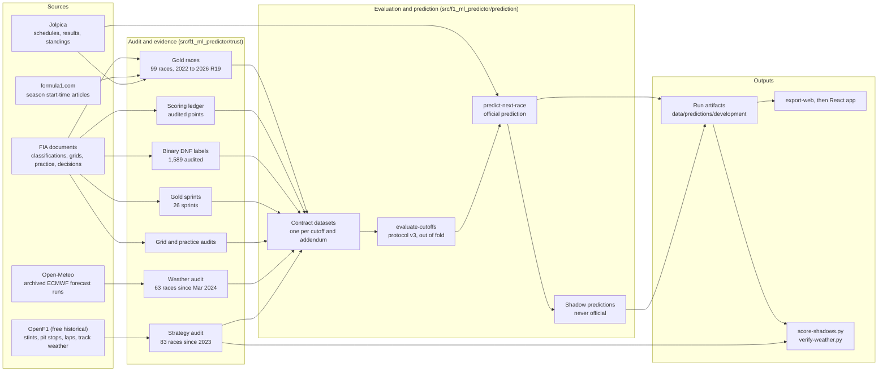
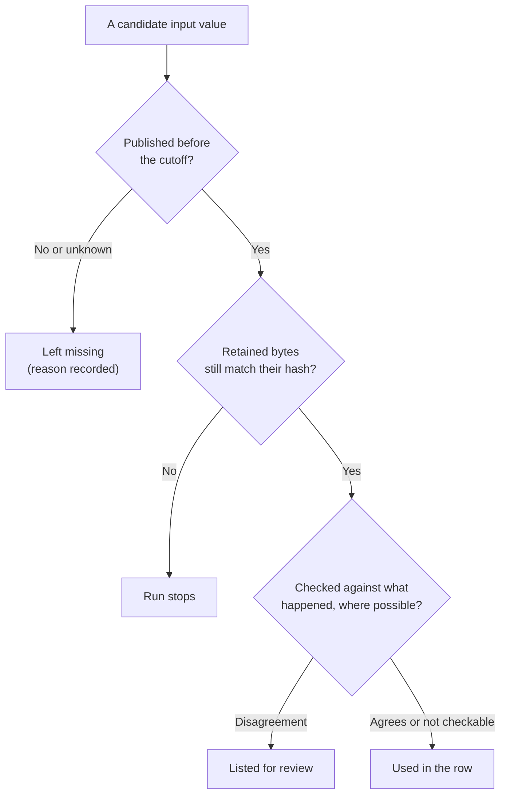
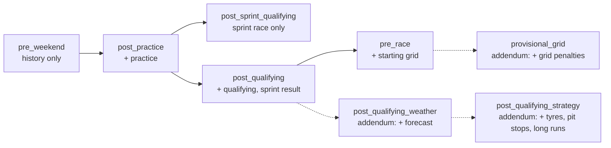
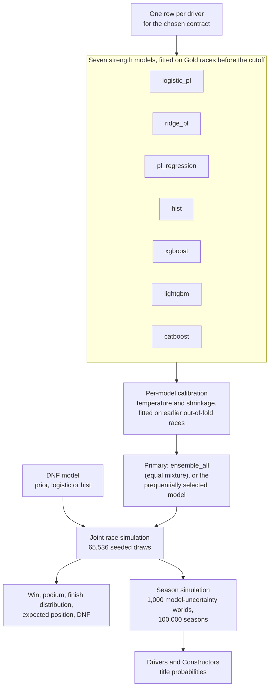
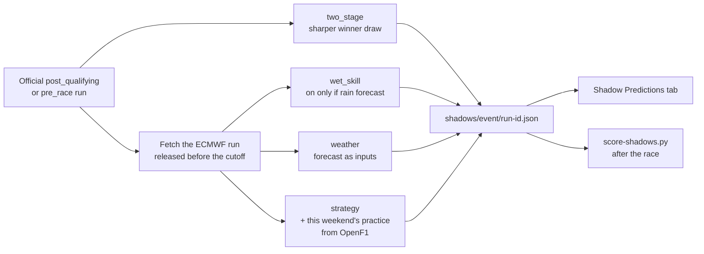
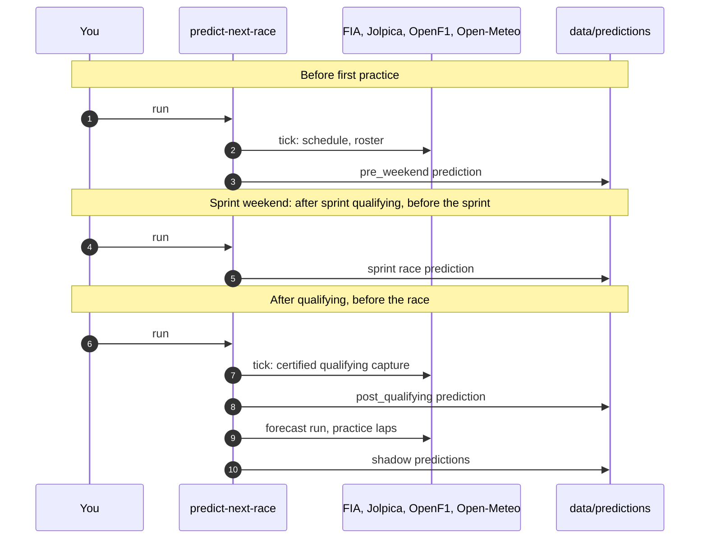
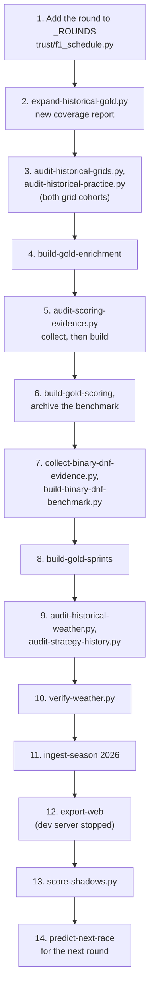
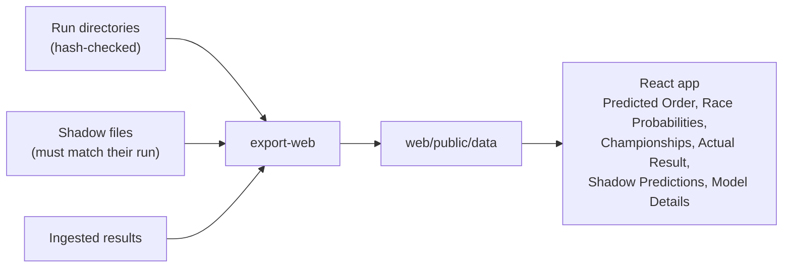

# Pipeline overview

How data becomes a prediction, how each prediction is checked, and what to run
on a race weekend. This page describes the pipeline as of 6 November 2026
(Gold through the 2026 Mexico City GP, round 19). Detailed contracts live in the
linked documents; dated reports such as
[the weather addendum](WEATHER_FORECAST_ADDENDUM_2026-11-06.md) record individual
decisions and are not edited afterwards.

## The whole system



Every arrow carries hash-bound files: an audit retains the exact bytes it read,
and every later step re-verifies those hashes before using them.

## Trust rules: what a prediction may know

A value can enter a prediction only if it was public before that prediction's
cutoff. Each source has a fixed rule for proving that.

| Source | Used for | Counts as available from |
| --- | --- | --- |
| FIA registry document | Results, grids, practice, penalties, points | Its registry publication minute plus one |
| formula1.com start-time article | The race clock that places each cutoff | Reviewed and bound per season |
| Jolpica | Schedules, live qualifying capture | Its capture time; historical times are unknown, so it is never Gold evidence |
| Open-Meteo archived ECMWF run | Forecast rain, temperature, wind | Initialisation plus 12 hours (published 4 to 6 hours after) |
| OpenF1 race data | Tyres, pit stops, laps, track weather | Race end plus 24 hours (free 30 minutes after) |
| OpenF1 practice data | Long-run pace | Session end plus 2 hours |

Evidence tiers: **Gold** (direct, publication-bounded evidence; the only tier
used for accuracy claims), **Silver** and **Development**. See
[data trust](DATA_TRUST.md) and [Gold workflow](GOLD_WORKFLOW.md).



The last check was added after the 2024 Brazil GP showed that a correct copy of
a forecast can still describe the wrong conditions. Forecasts are now compared
with the tyres teams fitted and the circuit weather station
(`scripts/verify-weather.py`).

## Cutoffs and contracts

A **contract** is the list of predictors allowed at one cutoff. Each contract is
evaluated separately and gets its own calibration and model selection.



Solid boxes are frozen protocol v3 contracts used for official predictions.
Dashed boxes are addenda: evaluated with the same method, stored under their own
key, and used only as shadows because none beat the base contract.

| Addendum | Adds | Paired result against its base | Status |
| --- | --- | --- | --- |
| `provisional_grid` (grid-addendum-v1) | Grid places lost, pit-lane start | Winner log loss +0.050, worse | Not used |
| `post_qualifying_weather` (weather-addendum-v2) | Forecast rain before and during, temperature, wind | -0.002, no change | Shadow |
| `post_qualifying_strategy` (strategy-addendum-v1) | Tyre degradation, pit-lane time, circuit stops, practice long runs | +0.031, worse | Shadow |

Predictors and their definitions are in the [feature dictionary](FEATURE_DICTIONARY.md).

## Inside one prediction



Winner, podium and finishing order all come from the same simulated races, so
they cannot contradict each other. Details: [modeling](MODELING.md),
[protocol v3](EVALUATION_PROTOCOL_V3.md), [simulation](SIMULATION.md).

## Shadow predictions

Shadows are candidate methods that failed the backtest gate but are worth
testing on races nobody has seen. They are frozen after the official outputs are
written and can never change them.



| Shadow | What it does | Backtest |
| --- | --- | --- |
| `two_stage` | Pools the members; one temperature for the winner, another for the rest | Winner log loss -0.047, not significant |
| `wet_skill` | Adds each driver's wet-minus-dry gain, learned from races that used intermediates or wets | -0.038 on forecast-wet races, not significant |
| `weather` | The weather addendum | No change |
| `strategy` | The strategy addendum | Worse (+0.031) |

A shadow becomes a candidate for the official model only if it keeps beating
the official run on new races. One weekend decides nothing.

## A race weekend

The Windows scheduled collector is disabled, so ticks are run by hand.
`predict-next-race` runs one collector tick first unless given `--no-collect`.



If Jolpica has not published qualifying two hours after its scheduled start, the
tick freezes the OpenF1 result instead and the run is marked provisional.

## After the race

Run these in order once the FIA final classification is out. Compare audited
counts with the previous run at each step.



| Step | Command | Notes |
| --- | --- | --- |
| 1 | edit `trust/f1_schedule.py` | Only if the round is in the season start-time article. A new substitute driver also needs a `_DRIVERS` entry in `trust/winter.py`. |
| 2 | `scripts/expand-historical-gold.py [--discovery <catalog>]` | Prints the new `five-year-coverage-*.json` |
| 3 | `scripts/audit-historical-grids.py <coverage>` (and `--cohort provisional_grid`), `scripts/audit-historical-practice.py <coverage>` | Reuse retained FIA bytes |
| 4 | `python -m f1_ml_predictor build-gold-enrichment` | |
| 5 | `scripts/audit-scoring-evidence.py collect`, then `build <collection>` | Bump `AUDIT_AS_OF` first; `collect` re-reads the current season only |
| 6 | `python -m f1_ml_predictor build-gold-scoring --benchmark-dir <enrichment>` | |
| 7 | `scripts/collect-binary-dnf-evidence.py`, `scripts/build-binary-dnf-benchmark.py <capture>` | |
| 8 | `python -m f1_ml_predictor build-gold-sprints` | |
| 9 | `scripts/audit-historical-weather.py <coverage>`, `scripts/audit-strategy-history.py <coverage>` | Without these the weather, wet-skill and strategy shadows are skipped |
| 10 | `scripts/verify-weather.py` | Forecast against fitted tyres and the track station |
| 11 | `python -m f1_ml_predictor ingest-season 2026` | The web page reads results from here, not from Gold |
| 12 | `python -m f1_ml_predictor export-web` | Stop the Vite dev server first: on Windows its file watcher blocks the folder swap |
| 13 | `scripts/score-shadows.py` | Rehearsal files are skipped |
| 14 | `python -m f1_ml_predictor predict-next-race` | Pre-weekend prediction for the next round |

## Viewing results



```powershell
.\.venv\Scripts\python.exe -m f1_ml_predictor export-web
cd web
npm run dev
```

The app never computes predictions; see [web frontend](WEB_FRONTEND.md).

## Where things live

| Path | Contents |
| --- | --- |
| `src/f1_ml_predictor/trust/` | Audits: Gold, grids, practice, sprints, weather, strategy, captures |
| `src/f1_ml_predictor/prediction/` | Contracts, evaluation, pipeline, shadows, web export |
| `scripts/` | Audit, rebuild, comparison and scoring scripts |
| `data/raw/` | Retained source bytes (ignored by git) |
| `data/benchmarks/` | Gold versions, audit reports, contract datasets |
| `models/experiments/gold/` | Cached out-of-fold evaluations |
| `data/predictions/development/next_race/` | Official runs |
| `data/predictions/development/shadows/` | Shadow runs |
| `web/` | React frontend |
